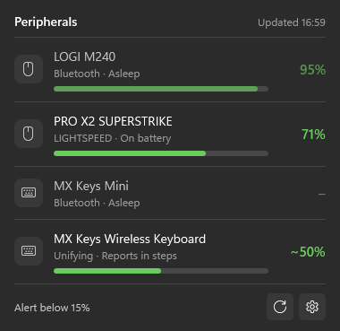
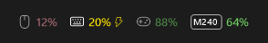
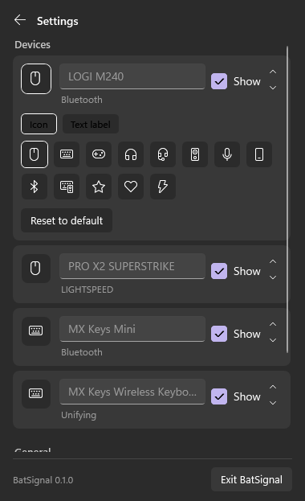

# BatSignal

See the battery level of your mouse, keyboard and other wireless peripherals right on the Windows 11 taskbar.


BatSignal puts a small widget next to the clock showing each device and its battery. Click it for details:



## Features

- **On the taskbar:** a device icon and percentage for each peripheral, colored green, amber or red by level.
- **Fallback to tray icons:** if the widget can't attach to the taskbar, each device gets a notification-area icon with its number inside a mouse or keyboard outline. The widget comes back on its own once the taskbar is available.
- **Flyout:** left-click to see every device, its connection, a battery bar and its status (on battery, charging, asleep and when it was last seen).
- **Make it yours:** rename devices, pick an icon or a short text label (handy with two mice), reorder them, and hide the ones you don't care about, all from the Settings page of the same panel.
- **Bluetooth:** any paired Bluetooth device that reports its battery to Windows, whatever the brand.
- **Low-battery alerts:** a Windows notification when a device drops below a threshold (15% by default; off, 10, 15, 20, 25 or 30%).
- **Sleeping devices:** wireless devices sleep when idle. BatSignal keeps their last reading, dimmed, instead of hiding them.
- **Light and dark theme** follows Windows.
- **Start with Windows**, from Settings.





## Supported devices

BatSignal reads battery from two sources.

**Bluetooth (any brand):** connected Bluetooth LE devices are read live from the standard Battery service. Other paired devices, including classic Bluetooth headsets, show the last level Windows stored (the one in Settings > Bluetooth & devices).

**Logitech receivers and USB:** BatSignal talks to devices directly with Logitech's HID++ 2.0 protocol, through:

- Unifying, Bolt and LIGHTSPEED receivers
- devices plugged in over USB

It reads battery from whichever HID++ feature the device supports:

| Feature | Used by | Notes |
|---|---|---|
| `0x1004` Unified Battery | Recent mice and keyboards | Exact percentage |
| `0x1000` Battery Status | MX Keys and other older devices | Some report only in steps (100/50/20/5); shown as `~50%` |
| `0x1001` Battery Voltage | Many G-series devices | Percentage estimated from voltage |

Tested with a PRO X2 SUPERSTRIKE (LIGHTSPEED) and an MX Keys (Unifying). It runs alongside G HUB and Logi Options+; you don't need to close them.

Not supported yet: other brands' own wireless dongles (Razer, Corsair, SteelSeries…), the Xbox Wireless Adapter, and Logitech headsets on LIGHTSPEED (see Roadmap).

## Install

Requirements: Windows 10 or 11 and the [.NET 10 Desktop Runtime](https://dotnet.microsoft.com/download/dotnet/10.0).

Build from source with the .NET 10 SDK:

```bash
dotnet publish src/BatSignal.App -c Release -r win-x64 --no-self-contained -p:PublishSingleFile=true -p:DebugType=none -o dist
```

Then run `dist\BatSignal.exe`. Open Settings (right-click the widget) and turn on **Start with Windows** to keep it running.

## Usage

- **Left-click** the widget or a tray icon to open the flyout.
- **Right-click**, or the gear in the panel, to open Settings: device names, icons, labels, order and visibility; taskbar or notification area; alert level; start with Windows; exit.

BatSignal checks every 2 minutes. It also refreshes when a device reports a battery change or reconnects.

### About the taskbar widget

Windows 11 has no official way to add things to the taskbar. BatSignal places its own small window inside the taskbar, next to the notification area (the same approach as tools like TrafficMonitor). It checks every second that it's still in place and re-attaches after Explorer restarts. If a Windows update ever breaks this, it switches to tray icons by itself.

The widget is on the main taskbar only. In tray mode, Windows 11 may put new icons in the overflow menu (^). Drag them next to the clock to keep them visible.

## Troubleshooting

- **Log:** `%APPDATA%\BatSignal\log.txt`. Settings and last known readings are stored in `settings.json` in the same folder.
- **Probe:** a console tool that lists every receiver, device and battery reading (`--bluetooth` lists Bluetooth devices instead).

  ```bash
  dotnet run --project src/BatSignal.Probe
  ```

  Add `--raw` to print every HID++ report, or `--monitor` to watch the app's polling loop for 40 seconds.
- **Preview:** `BatSignal.exe --preview <folder>` saves the widget, tray icons and flyout as PNG files.

## Project layout

```
src/
  BatSignal.Core/    HID++ protocol, Bluetooth battery provider and the device monitor
  BatSignal.App/     Taskbar widget and tray icons (WinForms), main panel with Settings (WPF), alerts
  BatSignal.Probe/   Console diagnostics
```

## Roadmap

- Xbox controllers on the Xbox Wireless Adapter (XInput), and wired/2.4 GHz gamepads
- Logitech LIGHTSPEED headsets
- Widget on secondary-monitor taskbars
- Installer and signed releases

## Credits

Protocol details come from the open-source [Solaar](https://github.com/pwr-Solaar/Solaar) project. Uses [HidSharp](https://www.zer7.com/software/hidsharp) for HID access.

BatSignal is not affiliated with or endorsed by Logitech. Logitech, Unifying, LIGHTSPEED and the product names mentioned are trademarks of their respective owners.

## License

[MIT](LICENSE)
