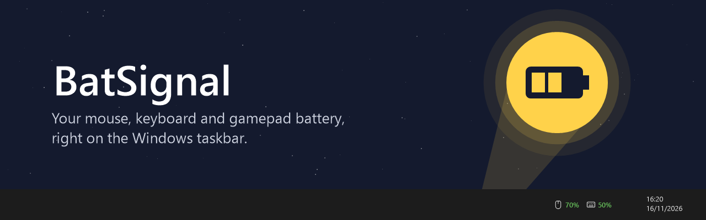
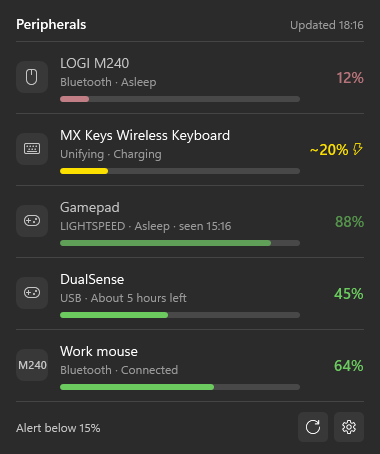

**Never get caught by a dead mouse again.**

BatSignal puts the battery level of your wireless mouse, keyboard and gamepad
right on the taskbar, next to the clock. One glance, no app to open.

Free, and everything stays on your computer.

### [⬇ Download for Windows](https://github.com/BeeeFX/BatSignal/releases/latest/download/BatSignal-win-Setup.exe)

Windows 10 and 11 · [All releases](https://github.com/BeeeFX/BatSignal/releases)

---

## See it

<table>
<tr>
<td width="34%" valign="top">

<b>Every device at a glance</b>

</td>
<td width="33%" valign="top">

<b>Make it yours</b>

</td>
<td width="33%" valign="top">

<b>Right on the taskbar</b>

</td>
</tr>
</table>

## What it does

- **Shows every battery on the taskbar.** A small icon and percentage per device, green, amber or red,
  next to the clock. Hover one for its name, status and time left. Click for the full panel.
- **Tells you how long you've got.** It learns how fast each battery drains and shows
  *About 2 days left*, so you know whether tonight's the night to charge.
- **Warns you before it's too late.** A Windows notification when a device drops below 15%
  (or whatever you choose), once per charge.
- **Remembers sleeping devices.** Wireless mice nap when you're not using them. BatSignal keeps the
  last reading, dimmed, instead of making the device disappear.
- **Lets you make it yours.** Rename devices, pick an icon or a short label like `M240` (handy with two
  mice), reorder them, and hide the ones you don't care about.
- **Stays out of the way.** No window, no account, nothing uploaded. If there's no room on the taskbar,
  it moves to the notification area by itself.

## Works with

| | |
| --- | --- |
| **Logitech** | Mice and keyboards on Unifying, Bolt or LIGHTSPEED receivers, or plugged in by USB. Read directly, so G HUB and Options+ can stay running (or not) |
| **Bluetooth** | Any brand, as long as the device reports its battery to Windows: most mice, keyboards, headphones and Xbox controllers |
| **Xbox controllers** | On the Xbox Wireless Adapter or a USB cable (low, medium or full) |
| **PlayStation** | DualSense and DualShock 4 over USB, and over Bluetooth when they're already sending full reports (Steam does this) |
| **Nintendo** | Switch Pro Controller, in full report mode |

Gamepad support follows each controller's published report format but hasn't been tried on real
controllers yet. If yours shows something odd, please [open an issue](https://github.com/BeeeFX/BatSignal/issues).

Not supported: other brands' own USB dongles (Razer, Corsair, SteelSeries…) and Logitech LIGHTSPEED headsets.

## Settings

Right-click the widget, or click the gear in the panel:

| | |
| --- | --- |
| **Devices** | Name, icon or text label, order, and whether each one shows |
| **Show battery in** | The taskbar, or the notification area |
| **Low-battery alert** | Off, or below 10–30% |
| **Start with Windows** | On by default after installing |
| **Notifications** | Send a test alert to see what they look like |

## Installing

Download the installer from [Releases](https://github.com/BeeeFX/BatSignal/releases/latest) and run it.
It installs just for you, so Windows won't ask for an administrator password. If the .NET 10 Desktop
Runtime isn't on your PC yet, the installer offers to fetch it.

> **Windows will warn you the first time.** The app isn't code-signed — a certificate costs a few
> hundred pounds a year, which is hard to justify for a free tool. Click **More info → Run anyway**.

Once installed, it keeps itself up to date: when a new version is ready, the panel shows a
**Restart to update** button.

Uninstall it like any other app, from Settings › Apps.

## Questions

**Does it need G HUB or Logi Options+?** No. It talks to the receivers itself, and doesn't mind if they're running.

**Does anything get uploaded?** No. It reads batteries on your PC and only goes online to check GitHub for updates.

**Why does my keyboard show `~50%`?** Some devices, like the MX Keys, only report 100, 50, 20 and 5%. The `~` says so.

**Where's the widget?** Next to the clock. If your taskbar is crowded, or on the side of the screen, BatSignal
switches to notification-area icons — Windows may tuck new ones under the **^**, so drag them out to keep them visible.

**Is it really free?** Yes, and the source is here for anyone to read.

## For developers

Building from source, how the battery reading works, the project layout and the release process are in
[docs/DEVELOPING.md](docs/DEVELOPING.md).

## Licence

MIT. See [LICENSE](LICENSE). Battery protocol details owe a lot to [Solaar](https://github.com/pwr-Solaar/Solaar)
and the Linux HID drivers.

Not affiliated with Logitech, Microsoft, Sony, Nintendo or DC. Product names are trademarks of their owners.
